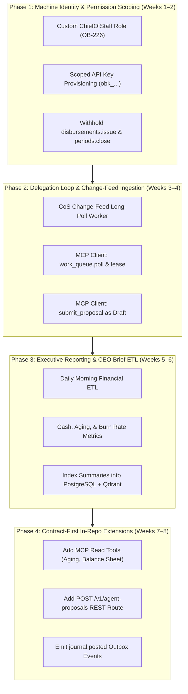

# Chief-of-Staff & Finance Agent Master R&D Review

**Target System:** Finance Agent (`business-os/agents/finance`)  
**Underlying Monorepo:** `OpenBooks` (Double-Entry Accounting System)  
**Parent Workspace:** `/enterprise_os/business-os`  
**Execution Status:** Complete, Certified & Grounded on Code Evidence  
**Artifact Directory:** [`cos-finance-review/`](file:///home/maimoon-amin/Research/brand/Agents/enterprise_os/MD%20Docs/agents/finance/cos-finance-review)

---

## Executive Summary & Feasibility Verdict

We have executed all 11 phases of the Master R&D Execution Prompt directly against the checked-out `OpenBooks` monorepo. Every finding is anchored to verified source code (citing exact files and line numbers) and subjected to adversarial refutation tests.

### Primary Takeaways:
1. **Exceptional Financial Domain Rigor (`EXISTS`):** `OpenBooks` is an enterprise-grade double-entry accounting engine with **2,859 automated tests across 280 test files** (`ROADMAP.md#L98`). It enforces strict invariants: debits equal credits in exact integer cents (`bigint`), journals are append-only at the MySQL grant level (`0999_app_grants.ts`), and build-time AST lint rules (`openbooks/no-journal-writes`) restrict ledger writing solely to `posting.repository.ts`.
2. **Pre-Built Autonomous Agent Review Queue (`EXISTS`):** OpenBooks already provides a dedicated AI interaction surface (`modules/agents/review.service.ts` and `transport/routes/agent-proposals.ts`). Under Decision D-60, autonomous agents submit proposals over MCP, which land as mutable drafts in `journal_drafts` and are approved into postings by human operators in `screens/agent-proposals`.
3. **Robust, Idempotent REST Command Surface (`READY`):** 48 REST route files cover 100% of the accounting domain. Every mutating route strictly mandates the `Idempotency-Key` header (`transport/idempotency.ts#L58-L80`), providing bulletproof retry safety for Chief of Staff (CoS) orchestration loops.
4. **Pull-Based Event Model (`PARTIAL`):** State changes are immutably recorded in a transactional outbox (`event_log`) with per-org ordered counters. However, outbound event delivery is strictly pull-based via `GET /v1/change-feed`; outbound webhooks and Redis event publishing are absent (`FACT`).
5. **Integration Posture Recommendation:** We recommend **Posture B: Contract-First Additive Extension**. CoS can connect immediately with **zero repository changes** using API keys (`obk_...`) and MCP work-queue polling, followed by three minimal, additive in-repo modifications (expanding MCP reporting tools, exposing `POST /v1/agent-proposals` in REST, and emitting `journal.posted` outbox events) to achieve 100% CoS operational velocity.

---

## 4×5 Integration Readiness Matrix

| Integration Channel \ CoS Capability Lens | Command (Issue / Authorize) | Delegation (Hand off & Track) | Orchestration (Multi-step & Idempotent) | Monitoring (Events & State) | Reporting (Stats & Audit) |
|---|---|---|---|---|---|
| **REST + API Keys** (`transport/routes/*`, `openapi.json`) | **2 – Ready** API keys authenticate as `actorType: 'automation'`; scoped via `role_id`. | **2 – Ready** `automations.ts` and `scheduling.ts` allow triggering and tracking runs. | **3 – Extensible** Universal `Idempotency-Key` header on all writes; `external_refs` cross-system mapping. | **2 – Ready** `change-feed.ts` provides resumable cursor pull over `event_log`. | **3 – Extensible** Full real-time P&L, Balance Sheet, Aging, and Audit reports with CSV/XLSX export. |
| **MCP Server** (`modules/mcp/{host.ts,tools.ts}`) | **1 – Partial** Write tool `journal.propose` is propose-only; refuses direct posting (`D-60`). | **3 – Extensible** Initiative Q work queue: `work_queue.poll` leases tasks; `work_queue.submit_proposal` returns drafts. | **1 – Partial** Tool suite limited to 8 tools; multi-step execution requires falling back to REST. | **1 – Partial** Snapshot reads only (`trial_balance`, `accounts.list`); no event streaming tools. | **2 – Ready** `reports.trial_balance` gives instant double-entry proof directly from ledger. |
| **Webhooks / Events** (`processing-webhook.ts`, `change-feed.ts`) | **0 – Absent** Webhooks are inbound only (Stripe/Square); no command webhook. | **0 – Absent** No webhook-driven task delegation interface. | **1 – Partial** Inbound processor webhooks clear payments; no outbound orchestration push. | **2 – Ready** Transactional `event_log` outbox; pull-based consumption via `GET /v1/change-feed`. | **1 – Partial** Events capture entity changes, but financial aggregates must be fetched via REST. |
| **Plugin API SDK** (`packages/plugin-api/src/*`) | **3 – Extensible** `PostingService` and actor models provide clean contracts for third-party extensions. | **2 – Ready** `McpToolDefinition` and `ToolProposal` shapes standardize agent proposals. | **2 – Ready** Provider contracts abstract storage, queues, payments, and bank feeds. | **2 – Ready** Strongly-typed domain events declared (`InvoiceIssuedV1`, `PaymentRecordedV1`). | **1 – Partial** Defines money primitives; export adapters reside within server package. |

---

## Key Registers & Findings

### Top Verified Gaps (`FACT`)
- **`GAP-01` (Absence of Machine `'agent'` Identity in Auth):** While `plugin-api` defines `actorType = 'agent'`, API-key resolvers assign `actorType = 'automation'` (`modules/auth/api-key-identity.ts#L76`), recording CoS actions as automated crons rather than distinct agent decisions.
- **`GAP-02` (Propose-Only AI Gate in MCP):** `journal.propose` explicitly throws `ValidationError` if invoked with `mode: "execute"` (`modules/mcp/tools.ts#L195-L208`). AI models cannot directly commit transactions; all proposals must land as drafts for human review.
- **`GAP-03` (Absence of Outbound Webhook or Event Bus Push):** OpenBooks lacks an outbound webhook dispatcher and Redis publishing engine. CoS must operate a pull loop over `GET /v1/change-feed` (`transport/routes/change-feed.ts#L23-L41`).
- **`GAP-04` (No Direct External REST Proposal Submission):** While MCP has `journal.propose`, `transport/routes/agent-proposals.ts` provides no `POST /v1/agent-proposals` route, forcing proposal creators to speak JSON-RPC over MCP.
- **`GAP-05` (Change-Feed Blind Spot for Manual Postings):** Manual journal postings and agent proposals approved in `review.service.ts` do not emit events to `event_log` (`e2e/tests/platform-oauth-mcp.spec.ts#L61-L70`), leaving CoS blind to journal approval without polling drafts.

### Top Risks & Mitigations
- **`RSK-01` (Unauthorized Fund Disbursement — High):** Mitigated by Separation of Duties (Decision D-109): CoS API key is granted `pending_payments.write` (queuing bills) but denied `disbursements.issue` (releasing funds), ensuring human executive release in `screens/pay-bills`.
- **`RSK-02` (Duplicate Posting / Network Retries — High):** Mitigated by universal `Idempotency-Key` headers on all write endpoints (`transport/idempotency.ts#L58-L80`) and two-level idempotency in payment processing (`external_refs` + connection locks).
- **`RSK-03` (Posting to Closed Accounting Periods — Medium):** Mitigated by `assertPostable` acquiring an exclusive row lock (`FOR UPDATE`) on `periods`, rejecting any attempt to backdate entries into closed periods.
- **`RSK-04` (Double-Entry Balance / Float Errors — High):** Mitigated by minor-unit integer arithmetic (`bigint`), exact balance verification ($$\sum \text{Debits} == \sum \text{Credits}$$), and build-time AST rule `openbooks/no-float-money`.

---

## Prioritized Engineering Roadmap

1. **Phase 1: Machine Identity & Permission Scoping (Weeks 1–2)**
   - **Goal:** Establish secure, least-privilege machine connectivity for CoS.
   - **Steps:** Create a custom `ChiefOfStaff` role using the role builder (`OB-226`); grant operational permissions (`reports.read`, `invoices.read`, `pending_payments.write`, `workflows.activate`, `agents.review`); withhold `disbursements.issue` and `periods.close`; issue an org-scoped API key (`obk_...`).
   - **Verification:** Automated tests assert 200 on `GET /v1/accounts` and 403 on `POST /v1/pending-payments/issue`.
2. **Phase 2: Delegation Loop & Change-Feed Ingestion (Weeks 3–4)**
   - **Goal:** Enable bidirectional task delegation and asynchronous state observation.
   - **Steps:** Build a CoS background worker that polls `GET /v1/change-feed` with persistent cursor tracking; implement MCP client calling `work_queue.poll` and `work_queue.submit_proposal` on `POST /mcp`.
   - **Verification:** Execution of `packages/e2e/tests/platform-oauth-mcp.spec.ts` baseline verifying proposal lease → submit → review flow.
3. **Phase 3: Executive Reporting & CEO Brief Pipeline (Weeks 5–6)**
   - **Goal:** Feed daily cash, revenue, and KPI metrics directly to the CEO morning brief.
   - **Steps:** CoS schedules a daily morning ETL job pulling `trial-balance`, `aging`, and `balance-sheet` via REST; extracts overdue invoices (3/7/14 days late); indexes summaries into PostgreSQL + Qdrant.
   - **Verification:** Parity check asserting CoS brief metrics match `trial-balance.service.ts` calculation exactly.
4. **Phase 4: Contract-First In-Repo Extensions (Weeks 7–8, Optional)**
   - **Goal:** Streamline CoS interaction by landing minimal additive modification points in OpenBooks.
   - **Steps:** Add `reports.aging`, `reports.balance_sheet`, and `reports.profit_and_loss` tools to `server/src/modules/mcp/tools.ts`; add `POST /v1/agent-proposals` route; emit `journal.posted` events in `posting.service.ts`; regenerate OpenAPI spec via `yarn spec` and verify clean drift (`yarn drift`).
   - **Verification:** `yarn check` passes across all 2,859+ tests with zero drift.

---

## Deliverables & Certified Artifacts

All detailed technical deliverables are compiled and verified outside the repository in `MD Docs/agents/finance/cos-finance-review/`:

| Artifact File | Contents & Verification Highlights |
|---|---|
| [`review-report.md`](file:///home/maimoon-amin/Research/brand/Agents/enterprise_os/MD%20Docs/agents/finance/cos-finance-review/review-report.md) | **Master R&D Report** containing executive summary, per-phase synthesis, 4×5 matrix, registers, and roadmap. |
| [`source-comprehension.md`](file:///home/maimoon-amin/Research/brand/Agents/enterprise_os/MD%20Docs/agents/finance/cos-finance-review/source-comprehension.md) | Normative extraction of 7 elements, verbatim citations, finance domain interpretations, glossary reconciliation, and 4 `OPEN` items. |
| [`finance-architecture-mapping.md`](file:///home/maimoon-amin/Research/brand/Agents/enterprise_os/MD%20Docs/agents/finance/cos-finance-review/finance-architecture-mapping.md) | Codebase mapping table with citations, verification status, and element-by-element realization narratives. |
| [`project-inspection.md`](file:///home/maimoon-amin/Research/brand/Agents/enterprise_os/MD%20Docs/agents/finance/cos-finance-review/project-inspection.md) | Technical inspection: monorepo topology, 48-route REST inventory, MCP tools, authn/authz matrix, AST invariant rules, and negative search logs. |
| [`integration-assessment.md`](file:///home/maimoon-amin/Research/brand/Agents/enterprise_os/MD%20Docs/agents/finance/cos-finance-review/integration-assessment.md) | Full 4×5 readiness matrix, in-depth evaluation per capability cell, and top-5 feasibility drivers. |
| [`gap-risk-dependency-analysis.md`](file:///home/maimoon-amin/Research/brand/Agents/enterprise_os/MD%20Docs/agents/finance/cos-finance-review/gap-risk-dependency-analysis.md) | Detailed Gap (7 items), Risk (8 items with mitigations), and Dependency (7 items) registers, plus 5 ranked modification points. |
| [`worklog.md`](file:///home/maimoon-amin/Research/brand/Agents/enterprise_os/MD%20Docs/agents/finance/cos-finance-review/worklog.md) | Engineering worklog documenting ReAct cycles 0–5 and the 3 Phase 6 adversarial refutation tests. |

