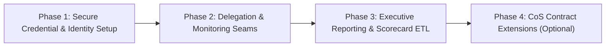

# Comprehensive R&D System Review & Chief-of-Staff Integration Readiness Report

**Project Scope:** Finance Agent (`business-os/agents/finance`)  
**Underlying Monorepo:** `OpenBooks/` (Yarn 4, TypeScript, Fastify, React, MySQL 8.4)  
**Deliverable Directory:** `/enterprise_os/MD Docs/agents/finance/cos-finance-review/`  
**Date of Audit:** 2026-11-14  
**Primary Evaluation Criterion:** The integration layer's ability to support future Chief of Staff (CoS) **command, delegation, orchestration, monitoring, and reporting**.

---

## Executive Summary

An end-to-end architectural and code-level investigation of the Finance Agent (`business-os/agents/finance`, realized by the `OpenBooks` double-entry accounting monorepo) was executed to assess its readiness for integration with an autonomous **Chief of Staff (CoS) agent**.

The audit verified that OpenBooks is an exceptionally well-engineered, production-ready double-entry financial system comprising **2,859 automated tests across 280 test files** (`ROADMAP.md#L98`), 48 REST route modules, an in-process JSON-RPC 2.0 MCP server, an append-only ledger kernel protected at the MySQL database grant level (`0999_app_grants.ts`), and an existing human-in-the-loop autonomous agent review queue (`modules/agents/review.service.ts`).

### Key Architectural Findings:
1. **Zero CoS Code in Monorepo:** OpenBooks contains no internal CoS implementation (`FACT`); it provides the integration receptacles (API keys, OAuth 2.1 AS, MCP host) that an external CoS commands.
2. **Strict Propose-Only AI Gate (Decision D-60):** The MCP server (`POST /mcp`) and agent work queue deliberately forbid autonomous ledger posting (`tools.ts#L195-L208`). AI models can only land mutable drafts in `journal_drafts`, requiring a human with `agents.review` and `journals.post` to inspect and approve them into postings.
3. **Robust REST Command Surface:** 48 REST route files provide complete, programmatic access to all financial capabilities. Every mutating endpoint strictly mandates the `Idempotency-Key` header (`transport/idempotency.ts#L58-L80`), guaranteeing safe retry semantics for CoS automation loops.
4. **Pull-Based Monitoring:** State changes are immutably written to a transactional outbox (`event_log`) with per-org sequence ordering (`modules/events/outbox.ts#L61-L80`). However, outbound push infrastructure (webhooks or Redis) is absent (`FACT`); CoS must poll `GET /v1/change-feed`.
5. **Change-Feed Blind Spot for Manual Postings:** Direct manual journal postings and agent proposals approved in `review.service.ts` do not emit `event_log` entries (`e2e/tests/platform-oauth-mcp.spec.ts#L61-L70`), requiring CoS to correlate proposal resolution explicitly.

---

## 1. Per-Phase Findings Synthesis

### Phase 1: Source Comprehension
- **Baseline Alignment:** Baseline documents (`Agents info.md`, `Recommended architecture.md`) define a federated multi-agent OS where independent agents retain private repos, databases, and UIs.
- **Finance Responsibilities:** Expense categorization, automated invoice dunning (at 3, 7, and 14 days late), bank reconciliation, and cash flow forecasting.
- **Glossary Reconciliation:** OpenBooks strictly formalizes accounting invariants (Journals, Trial Balance, Fiscal Periods, Clearing Accounts, Minor Units, Actor Provenance). CoS is an external concept. Four `OPEN` questions were logged (`source-comprehension.md`).

### Phase 2: Architecture Mapping
- **Seven Core Elements Mapped:**
  - Chief of Staff Agent: `ABSENT` internally / `EXISTS` as external receptacle.
  - Independent Specialized Agent: `EXISTS` (`OpenBooks/` platform).
  - Internal Orchestrators: `EXISTS` (`entrypoints/worker.ts`, `modules/scheduling/tick.ts`, `modules/automations/engine.ts`).
  - Individual UI: `EXISTS` (`packages/web`, 40 React screens).
  - Integration Layer: `PARTIAL` (REST and MCP ready; outbound webhooks/Redis absent).
  - Shared Intelligence: `PARTIAL` (Authoritative ledger kernel and reporting ready; vector RAG absent).
  - Controlled Data Access: `EXISTS` (`0999_app_grants.ts`, AST invariant `no-journal-writes.js`, `tenantDb`, `catalog.ts`, `field-encryption.ts`).

### Phase 3: Project Inspection
- **Runtime Topology:** One Docker image dispatched via `OPENBOOKS_ROLE` into `api`, `worker`, or `migrate` (`entrypoints/main.ts#L1-L35`).
- **Money Safety Architecture:**
  - Immutability enforced by MySQL grants (`openbooks_app` holds no `UPDATE`/`DELETE` on `journals` and `journal_lines`, `0999_app_grants.ts#L17-L22`).
  - Build-time AST lint rule `openbooks/no-journal-writes` restricts ledger writing to `posting.repository.ts`.
  - Invariant $$\sum \text{Debits} == \sum \text{Credits}$$ enforced in exact integer minor units (`bigint`).
  - Fiscal period row locks (`FOR UPDATE`) prevent postings into closed accounting periods (`posting.service.ts#L131`).
  - AES-256-GCM encryption for sensitive PII (vendor TINs) via `field-encryption.ts`.
- **Identity & Tenancy:** Multi-tenancy strictly enforced via `tenantDb(orgId)` with composite keys `(org_id, id)`. API keys authenticate non-interactively, resolving to `actorType = 'automation'` bound to a specific `role_id` (`auth/api-key-identity.ts#L72-L78`).

---

## 2. 4×5 Integration Readiness Matrix

| Integration Channel \ CoS Lens | Command (Issue / Authorize) | Delegation (Hand off & Track) | Orchestration (Multi-step & Idempotent) | Monitoring (Events & State) | Reporting (Stats & Audit) |
|---|---|---|---|---|---|
| **REST + API Keys** | **2 – Ready** `api-keys.ts#L46` `api-key-identity.ts#L60` | **2 – Ready** `automations.ts#L99` `agent-proposals.ts#L61` | **3 – Extensible** `transport/idempotency.ts#L1` `external-refs.ts#L20` | **2 – Ready** `change-feed.ts#L23` `health.ts#L1` | **3 – Extensible** `reports.ts#L1` `export/adapters.ts#L1` |
| **MCP Server** | **1 – Partial** `tools.ts#L175` `host.ts#L354` | **3 – Extensible** `tools.ts#L255` `tools.ts#L281` | **1 – Partial** `tools.ts#L195` `host.ts#L1` | **1 – Partial** `tools.ts#L117` | **2 – Ready** `tools.ts#L117` `tools.ts#L83` |
| **Webhooks / Events** | **0 – Absent** (Inbound only; no command hook) | **0 – Absent** (No webhook-driven delegation) | **1 – Partial** `processing-webhook.ts#L1` `outbox.ts#L61` | **2 – Ready** `change-feed.ts#L23` `outbox.ts#L61` | **1 – Partial** `outbox.ts#L61` |
| **Plugin API SDK** | **3 – Extensible** `posting.ts#L1` `actor.ts#L1` | **2 – Ready** `mcp.ts#L1` `events.ts#L1` | **2 – Ready** `providers.ts#L1` `context.ts#L1` | **2 – Ready** `events.ts#L1` `actor.ts#L24` | **1 – Partial** `primitives.ts#L1` |

---

## 3. Registers Summary

### 3.1 Gap Register (7 Key Gaps)
- **GAP-01:** API-key resolver assigns `actorType = 'automation'` rather than `'agent'`.
- **GAP-02:** MCP write tools are strictly propose-only (no autonomous direct posting).
- **GAP-03:** Absence of outbound webhook dispatcher or Redis event bus.
- **GAP-04:** No direct external REST endpoint to submit journal proposals (`POST /v1/agent-proposals`).
- **GAP-05:** Absence of semantic vector/RAG sync seams for enterprise shared intelligence.
- **GAP-06:** Limited MCP tool coverage (8 tools vs 48 REST routes).
- **GAP-07:** Manual and approved journal postings do not emit outbox events.

### 3.2 Risk Register (Top Finance Risks & Mitigations)
- **RSK-01 (High): Unauthorized Fund Disbursement.** Mitigated by Separation of Duties (Decision D-109): withhold `disbursements.issue` from CoS key; grant only `pending_payments.write`.
- **RSK-02 (High): Duplicate Posting Under Network Retries.** Mitigated by mandatory `Idempotency-Key` headers on all mutating routes (`transport/idempotency.ts`).
- **RSK-03 (Medium): Posting to Closed Periods.** Mitigated by `assertPostable` row locks on fiscal periods.
- **RSK-04 (High): Double-Entry Balance Corruption.** Mitigated by minor-unit `bigint` typing and `posting.service.ts` balance enforcement.
- **RSK-05 (High): Cross-Tenant Leakage.** Mitigated by `tenantDb(orgId)` composite key scoping and build-time dependency rules.

### 3.3 Ranked Modification Points (Minimal-Touch Order)
1. **`server/src/modules/mcp/tools.ts` (Additive, Minimal Blast Radius):** Expand MCP tool suite with `reports.aging`, `reports.balance_sheet`, and `scheduling.run_due_work`.
2. **`server/src/transport/routes/agent-proposals.ts` (Additive, Low Blast Radius):** Add `POST /v1/agent-proposals` route allowing REST submission of proposals.
3. **`server/src/modules/auth/api-key-identity.ts` (Additive, Low-Medium Blast Radius):** Allow API keys to declare `actor_type = 'agent'` with dedicated agent identifier.
4. **`server/src/modules/ledger/posting.service.ts` (Additive, Medium Blast Radius):** Emit outbox events on manual and approved journal postings.
5. **`server/src/modules/events/` (Invasive, High Blast Radius):** Implement an outbound HTTP webhook dispatcher worker with HMAC signing.

---

## 4. Goal-Oriented Next-Step Recommendations

### 4.1 Integration Posture Decision: **Contract-First Extension (Option B)**
It is recommended that the engineering team adopt **Posture B: Contract-First Extension**, staged in two phases:
- **Phase A (Consume-Only Immediate Start):** CoS connects immediately without modifying OpenBooks. CoS provisions an API key via `screens/api-keys`, executes operational commands over REST using `Idempotency-Key`, polls the work queue over MCP (`work_queue.poll`), and pulls `GET /v1/change-feed` for events.
- **Phase B (Contract-First Additive Enhancements):** Execute Modification Points 1, 2, and 4 in OpenBooks: expand MCP read tools, expose `POST /v1/agent-proposals`, and emit `journal.posted` outbox events.
- **Justification:** Consume-only is immediately functional, but adding the three minor additive modification points eliminates the change-feed blind spot, unifies proposal submission across REST/MCP, and exposes core executive reports (P&L, Aging) directly to CoS over MCP.

---

### 4.2 Sequenced Integration Roadmap

#### Phase 1: Machine Identity & Permission Scoping (Weeks 1–2)
- **Goal:** Establish secure, least-privilege machine connectivity for CoS.
- **Concrete Steps:**
  1. Define a dedicated `ChiefOfStaff` role using the custom role builder (`server/src/modules/permissions/roles.ts`, `OB-226`).
  2. Grant non-disbursing permissions: `reports.read`, `invoices.read`, `bills.read`, `accounts.read`, `pending_payments.write`, `workflows.read`, `workflows.activate`, `agents.review`. Explicitly omit `disbursements.issue` and `periods.close`.
  3. Issue an org-scoped API key (`obk_...`) via `POST /v1/api-keys`.
- **CoS Lens Unlocked:** Command & Authorization.
- **Verification Method:** Authenticated REST smoke tests verifying 200 on `GET /v1/accounts` and 403 on `POST /v1/pending-payments/issue`.

#### Phase 2: Delegation Loop & Change-Feed Ingestion (Weeks 3–4)
- **Goal:** Enable bi-directional task delegation and asynchronous state observation.
- **Concrete Steps:**
  1. Build a CoS background worker that long-polls `GET /v1/change-feed` with persistent cursor storage in CoS state.
  2. Implement CoS MCP client calling `work_queue.poll` on OpenBooks' `POST /mcp` to lease pending financial tasks.
  3. Connect CoS reasoning engine to call `work_queue.submit_proposal` returning structured journal drafts.
- **CoS Lens Unlocked:** Delegation & Monitoring.
- **Verification Method:** Execution of `packages/e2e/tests/platform-oauth-mcp.spec.ts` baseline narrative proving proposal lease → submit → review flow.

#### Phase 3: Executive Reporting & CEO Brief Pipeline (Weeks 5–6)
- **Goal:** Power the daily CEO brief and KPI scorecards from authoritative OpenBooks figures.
- **Concrete Steps:**
  1. CoS schedules a daily morning ETL job calling `GET /v1/reports/trial-balance`, `GET /v1/reports/aging`, and `GET /v1/reports/balance-sheet`.
  2. Extract key cash positions, total AR/AP outstanding, overdue buckets (3/7/14 days), and 30-day burn rate.
  3. Index executive financial summaries into enterprise PostgreSQL + Qdrant shared intelligence layer.
- **CoS Lens Unlocked:** Reporting & Shared Intelligence.
- **Verification Method:** Automated parity check asserting CoS brief metrics match `modules/reports/trial-balance.service.ts` calculation exactly.

#### Phase 4: Contract-First In-Repo Extensions (Weeks 7–8, Optional)
- **Goal:** Streamline CoS interaction by landing minimal additive modification points in OpenBooks.
- **Concrete Steps:**
  1. Land Modification Point 1: Add `reports.aging`, `reports.balance_sheet`, and `reports.profit_and_loss` tools to `server/src/modules/mcp/tools.ts`.
  2. Land Modification Point 2: Add `POST /v1/agent-proposals` route in `server/src/transport/routes/agent-proposals.ts`.
  3. Land Modification Point 4: Add `emitEvent` call in `server/src/modules/ledger/posting.service.ts` for journal postings.
  4. Run `yarn drift` and `yarn check` to regenerate `openapi.json` and verify zero drift.
- **CoS Lens Unlocked:** Streamlined Command & Complete Monitoring.
- **Verification Method:** `yarn check` passes (2,859+ tests) and `yarn drift` succeeds clean.

---

### 4.3 Risk Burn-Down Plan

| Roadmap Phase | Risk Retired | Mechanism of Retirement | Mandatory Finance Gate |
|---|---|---|---|
| **Phase 1** | **RSK-01 (Unauthorized Disbursement)** & **RSK-05 (Cross-Tenant Leakage)** | Separation of Duties enforced at role level (`pending_payments.write` only). TenantDb scoping bound to key's `org_id`. | **Gate 1:** Zero `disbursements.issue` grant in CoS role; test verifies 403 on disbursement release. |
| **Phase 2** | **RSK-02 (Duplicate Posting / Network Retries)** & **RSK-06 (Change-Feed Blind Spots)** | Universal `Idempotency-Key` headers on all write calls. CoS explicitly tracks proposal resolution via draft status queries. | **Gate 2:** Every mutating CoS call passes unique UUID idempotency key; replay returns byte-identical response. |
| **Phase 3** | **RSK-04 (Double-Entry Invariant / Float Errors)** | Reports read authoritative ledger state computed in `bigint` minor units without floating-point math. | **Gate 3:** Reconciliation check: $$\sum \text{Debits} == \sum \text{Credits}$$ verified against trial balance oracle. |
| **Phase 4** | **RSK-08 (Audit Provenance Dilution)** | Additive modification points add explicit event emission and agent origin metadata. | **Gate 4:** `audit.read` report verifies actor provenance records CoS agent identity. |

---

### 4.4 Open Decisions for Architecture Owners

The following four open decisions require explicit resolution from enterprise architecture stakeholders:

1. **[OPEN-1] Machine Principal Identity Model:**  
   *Question:* Should OpenBooks add a dedicated `actor_type = 'agent'` credential to `api_keys` (Modification Point 3), or should CoS continue to authenticate under `actorType = 'automation'`?  
   *Input Needed:* Decision on whether audit compliance mandates distinguishing autonomous AI agent actions from recurring background cron jobs in `journals.actor_type`.
2. **[OPEN-2] Autonomous Posting Autonomy vs. Human Approval:**  
   *Question:* Will CoS ever be permitted to autonomously post journals to the ledger (bypassing the `agents.review` queue for small amounts, e.g. < \$100), or must 100% of agent proposals remain strictly gated by human approval (Decision D-60)?  
   *Input Needed:* Executive policy on financial delegation thresholds and human-in-the-loop requirements.
3. **[OPEN-3] Event Ingestion Architecture (Push vs. Pull):**  
   *Question:* Is the enterprise architecture comfortable with CoS running a cursor-based polling worker against `GET /v1/change-feed` (every 10–30s), or is an outbound webhook/Redis publisher strictly required?  
   *Input Needed:* Event delivery latency SLA and infrastructure preference (polling pull vs event broker push).
4. **[OPEN-4] Shared Intelligence Sync Ownership:**  
   *Question:* Does CoS own the scheduled extraction of OpenBooks metrics into PostgreSQL + Qdrant, or should OpenBooks ship a dedicated background exporter?  
   *Input Needed:* Boundary definition between agent domain reporting and central knowledge store ETL.

