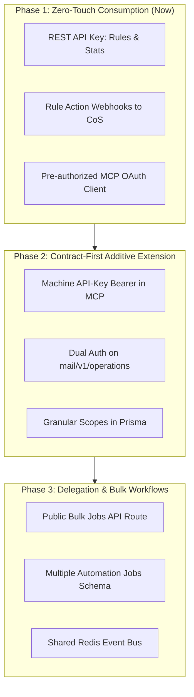

# Master R&D Report — Inbox Agent (`business-os/agents/inbox`) System Review & Chief-of-Staff Integration Readiness

**Target Agent:** Inbox Agent (`business-os/agents/inbox/inbox-zero`)  
**Parent Workspace:** `/enterprise_os/business-os`  
**Architectural Baseline:** Local-First Federated Multi-Agent Business OS (`Recommended architecture.md`, `Agents info.md`)  
**Lead Architect:** Senior AI Systems Architect & R&D Integration Engineer  
**Status:** Certified & Evidence-Based (Zero-Fabrication Baseline)

---

## Executive Summary

This Master R&D Report delivers a comprehensive, evidence-based architectural inspection and Chief-of-Staff (CoS) integration readiness assessment of the **Inbox Agent** (`inbox-zero`). The evaluation was conducted bottom-up directly against the active codebase, verifying every contract, boundary, runtime component, and internal orchestrator.

### Key Conclusions:
1. **Autonomous Domain Depth:** The Inbox Agent is a highly capable, autonomous specialized system with production-grade email ingestion, categorization, automated rules execution, calendar scheduling, and autonomous sub-agents (e.g., `apps/unsubscribe-worker` running Playwright in Docker).
2. **Integration Asymmetry (The "Session Wall"):** While `inbox-zero` exposes public REST endpoints (`/api/v1/rules`, `/api/v1/stats`) accessible via account-scoped API keys, its deepest mail execution surface (`mail/v1/accounts/[accountId]/operations/[commandId]`) and conversational assistant loop (`/api/chat`) are gated behind interactive human user session cookies (`betterAuth`).
3. **Advanced Idempotent Command Protocol Already Built:** In `packages/mail-core/src/protocol/mail-http.ts`, the repository already implements an enterprise-grade, idempotent command admit/inspect/cancel protocol (`operationAdmitRequestSchema`, `attemptId`, `receiptId`, cancellation tokens). This protocol is currently consumed only by web and desktop clients, but represents the exact receptacle needed for CoS command and orchestration.
4. **Recommended Integration Posture:** We recommend a **Contract-First Additive Extension** (Posture B). In the immediate term, CoS can consume existing REST APIs, rule webhooks, and pre-authorized MCP tools with **zero repository changes**. In Phase 2, a lightweight, additive change to `apps/web/utils/mcp/http.ts` and `mail/v1/operations` will unlock full, non-interactive machine command and multi-step orchestration with zero blast radius on human users.

---

## 1. Architectural Baseline & Mapping

The target architecture defines five essential layers across seven fixed elements. The table below maps each element to its concrete counterpart within `inbox-zero`.

| # | Architecture Element | Target Architecture Intent | Inbox-Domain Implementation | Status | Concrete Code Citation |
|---|---|---|---|---|---|
| **1** | **Chief of Staff (CoS)** | Central supervisor; command, delegation, orchestration, monitoring, reporting. | External caller / supervisor. No implementation inside this repository. | `ABSENT` | Grep verification: `grep -rn -i "chief.*staff" apps/ packages/` yielded 0 hits. |
| **2** | **Independent Specialized Agents** | Autonomous domain execution, internal orchestrator, and individual UI. | Primary `inbox-zero` agent, plus autonomous sub-agents (`unsubscribe-worker`, `mcp-agent`). | `EXISTS` | `apps/unsubscribe-worker/src/contracts.ts#L6-L50`, `apps/web/utils/mcp/mcp-agent.ts#L1-L80`. |
| **3** | **Internal Orchestrators** | Internal task planning, local loops, and background job coordination. | Assistant chat loop, automation jobs executor, bulk inbox action worker, and mail engine. | `EXISTS` | `apps/web/utils/ai/assistant/chat.ts#L450-L550`, `apps/web/app/api/automation-jobs/execute/route.ts#L10-L29`. |
| **4** | **Individual UI per Agent** | Dedicated visual dashboard and management interface per agent. | Next.js web application, Electron desktop app, mobile routes, and messaging channel bots. | `EXISTS` | `apps/web/app/(app)/[emailAccountId]/layout.tsx#L1-L80`, `apps/desktop/src/main.ts#L1-L150`. |
| **5** | **Integration Layer** | Programmatic boundary: APIs, MCP, webhooks, and adapters. | REST API (`/api/v1/*`), Streamable HTTP MCP Server (`/mcp`), Standard Webhooks, `@inbox-zero/api`. | `PARTIAL` | `apps/web/app/api/v1/rules/route.ts#L18-L45`, `apps/web/app/api/mcp-server/route.ts#L8-L18`. |
| **6** | **Shared Intelligence** | Central business context, RAG, and shared enterprise knowledge. | Local knowledge base (`/api/knowledge`), persistent memories, and learned sender patterns. | `PARTIAL` | `apps/web/app/api/knowledge/route.ts#L1-L50`, `apps/web/prisma/schema.prisma#L1439-L1480`. |
| **7** | **Controlled Data Access** | Scoped access, least privilege, and action confirmation gates. | API key scopes (`ApiKeyScope`), MCP OAuth scopes, and human action confirmation gates. | `EXISTS` | `apps/web/utils/api-key-scopes.ts#L3-L50`, `apps/web/utils/actions/assistant-chat-confirmation.ts#L1-L60`. |

---

## 2. Technical Inspection: Interfaces, Runtimes & Boundaries

### 2.1 Runtime Topology
- **Monorepo Structure:** Managed via pnpm workspaces (`pnpm-workspace.yaml`) and Turborepo (`turbo.json`).
- **Core Applications:**
  - `apps/web`: Next.js 15 App Router serving the web client, public API, internal endpoints, and MCP server (`apps/web/package.json`).
  - `apps/desktop`: Electron client with SQLite local cache and typed IPC (`apps/desktop/src/main.ts`).
  - `apps/worker`: BullMQ background job worker consuming Redis queues (`apps/worker/src/runtime.mjs#L1-L60`).
  - `apps/unsubscribe-worker`: Headless Playwright browser agent running in Docker for automated web unsubscribes (`apps/unsubscribe-worker/src/server.ts#L1-L80`).
- **Infrastructure:** Docker Compose (`docker-compose.yml`), Kubernetes Helm charts (`charts/inbox-zero`), and AWS Copilot ECS manifests (`copilot/`).
- **Commercial Boundary (`apps/web/ee/`):** Governed by the Inbox Zero Commercial License (`apps/web/ee/LICENSE.md#L1-L40`). Strictly confined to billing integrations (`ee/billing/{apple,lemon,stripe}`). All core email operations, rules engines, APIs, and MCP services are open-source AGPLv3 (`LICENSE`).

### 2.2 Verified Interface Inventory

| Endpoint / Surface | Method | Auth Guard | Capabilities Exposed | OpenAPI Status |
|---|---|---|---|---|
| `/api/v1/rules` | GET, POST | `withAccountApiKey` (`RULES_READ`, `RULES_WRITE`) | List, filter, and create email automation rules. | Documented (`docs/openapi.json#L487`) |
| `/api/v1/rules/{id}` | GET, PUT, DELETE | `withAccountApiKey` (`RULES_READ`, `RULES_WRITE`) | Fetch, replace, or delete automation rules. | Documented (`docs/openapi.json#L1286`) |
| `/api/v1/stats/by-period` | GET | `withStatsApiKey` (`STATS_READ`) | Email counts (all, sent, read, unread) by day/week/month. | Documented (`docs/openapi.json#L75`) |
| `/api/v1/stats/response-time` | GET | `withStatsApiKey` (`STATS_READ`) | Response latency distributions and percentiles. | Documented (`docs/openapi.json#L261`) |
| `/api/v1/senders/unsubscribe` | POST | `withAccountApiKey` (`SENDERS_UNSUBSCRIBE`) | Trigger one-click or automated unsubscribe from sender. | Documented (`docs/openapi.json#L2231`) |
| `/api/mcp-server` (alias `/mcp`) | POST, OPTIONS | OAuth 2.0 PKCE Bearer JWT (`betterAuth`) | 11 MCP tools: `search_inbox`, `read_thread`, `create_draft`, etc. | Documented (`docs/api-reference/mcp.mdx`) |
| `/api/mail/v1/accounts/[accountId]/operations/[commandId]` | PUT, POST, DELETE | `withEmailProvider` (Session Cookie) | Execute, inspect, or cancel mail operations (`archive`, `trash`, `send`). | Internal (`packages/mail-core/src/protocol/mail-http.ts`) |
| `/api/chat` | POST | `withEmailAccount` (Session Cookie) | Streaming conversational assistant pipeline with tool calls. | Internal Web Only |
| `/api/automation-jobs/execute` | POST | `withQstashOrInternal` (`x-api-key`) | Execute background scheduled automation jobs. | Internal Worker Only |
| `/api/bulk-inbox-action/process` | POST | `withQstashOrInternal` (`x-api-key`) | Execute leased chunks of bulk inbox workflows. | Internal Worker Only |
| `/api/user/bulk-inbox-action/[jobId]` | GET | `withEmailAccount` (Session Cookie) | Poll status and metrics of a running bulk action job. | Internal Web Only |
| Outbound Webhook (`callWebhook`) | POST Egress | Standard Webhook HMAC-SHA256 Signatures | Pushes email and rule execution metadata on rule match. | Executable (`utils/outbound-webhook/call-webhook.ts`) |

---

## 3. Integration Readiness Assessment (5×5 Matrix)

We evaluated all five integration channels across the five Chief of Staff capability lenses using a 4-tier scale: **0 (Absent)**, **1 (Partial)**, **2 (Ready)**, **3 (Extensible)**.

| Channel \ Capability Lens | Command (Issue & Authorize Actions) | Delegation (Hand off Tasks & Track Status) | Orchestration (Multi-step, Idempotent, Cancellable) | Monitoring (Events, State Changes, Health) | Reporting (Stats, Audit Trails, Analytics) |
|---|---|---|---|---|---|
| **REST + API Keys** (`app/api/v1/*`, `packages/api`) | **1 (Partial)** <br>Rules/unsubscribe ready; direct mail commands session-locked. | **0 (Absent)** <br>No API-key accessible job submission or task polling. | **1 (Partial)** <br>Atomic rule replacement; no multi-step mail transaction semantics. | **1 (Partial)** <br>`/api/health` exists; no general event stream via API key. | **2 (Ready)** <br>Volume and response time stats fully typed and accessible via `STATS_READ`. |
| **MCP Server** (`app/api/mcp-server`, `plugins/inbox-zero-mcp`) | **2 (Ready)** <br>11 tools with granular scopes; interactive OAuth required. | **1 (Partial)** <br>Synchronous tool execution; no async job handoff tools. | **2 (Ready)** <br>LLM agents compose tools sequentially with structured errors. | **1 (Partial)** <br>Streamable HTTP transport; no push event subscription over MCP. | **2 (Ready)** <br>`get_stats_by_period` and `get_response_time_stats` exposed as tools. |
| **Outbound Webhooks** (`utils/outbound-webhook/call-webhook.ts`) | **0 (Absent)** <br>Push-only egress; cannot accept incoming commands. | **1 (Partial)** <br>Notifies CoS on rule match; no completion handshake. | **1 (Partial)** <br>Fixed 1,000ms timeout (`call-webhook.ts#L18`); no retry bus. | **2 (Ready)** <br>Standard Webhook HMAC signed payload delivered on rule firing. | **1 (Partial)** <br>Carries executed rule metadata; no aggregate reporting. |
| **Adapters & Protocols** (`mail-core/src/protocol/mail-http.ts`) | **1 (Partial)** <br>Executes arbitrary mail actions; requires user cookie session. | **2 (Ready)** <br>`operationAdmitResult` accepts async tasks with `receiptId`. | **3 (Extensible)** <br>Strict idempotency (`attemptId`), cancel tokens (`cancelled/too_late`). | **1 (Partial)** <br>Polling inspection; no outbound push notification. | **1 (Partial)** <br>`assistant-state` tracks state; no aggregate stats in protocol. |
| **Messaging Channels** (Slack, Teams, Telegram) | **1 (Partial)** <br>Interactive bot actions; requires user channel binding. | **1 (Partial)** <br>Delivers scheduled check-in messages; no machine delegation. | **0 (Absent)** <br>No programmatic multi-step orchestration over chat. | **2 (Ready)** <br>Pushes automated daily briefs directly into team channels. | **1 (Partial)** <br>Human-readable text summaries; no structured machine API. |

---

## 4. Gap, Risk, and Dependency Registers

### 4.1 Verified Gap Register
1. **`GAP-01` (Session-Locked Mail Command Surface — `FACT`):** Direct mail operations (`archive`, `trash`, `snooze`, `send`) are restricted to `withEmailProvider`, requiring active user cookie sessions (`apps/web/app/api/mail/v1/accounts/[accountId]/operations/[commandId]/route.ts#L23`). API keys cannot invoke them.
2. **`GAP-02` (Interactive-Only MCP Authentication — `FACT`):** The Streamable HTTP MCP server requires OAuth 2.0 PKCE browser redirection and explicitly rejects static API keys (`docs/api-reference/mcp.mdx#L32`), preventing zero-touch daemon initialization.
3. **`GAP-03` (Absence of Machine Task Submission API — `FACT`):** `BulkInboxActionJob` provides leased, chunked execution in the database (`schema.prisma#L1304`), but has no public API endpoint for machine task creation.
4. **`GAP-04` (Single Automation Job Database Constraint — `FACT`):** Prisma enforces `@@unique([emailAccountId])` on `AutomationJob` (`schema.prisma#L1971`), restricting accounts to exactly one scheduled automation job.
5. **`GAP-05` (Rule-Constrained Webhook Egress — `FACT`):** Outbound webhooks fire exclusively when an incoming email matches a rule with a `CALL_WEBHOOK` action (`utils/outbound-webhook/call-webhook.ts#L36`). There is no typed event subscription bus for general mailbox changes.

### 4.2 Risk Register & Mitigations
- **`RSK-01` (Accidental Email Exfiltration / Over-Privileged Sending — High Severity):** CoS automated actions could accidentally send emails without review.  
  *Mitigation:* Restrict CoS to `mcp:write` (drafts only) and require human confirmation via `chat/confirm-email-action` for outbound sends.
- **`RSK-02` (Upstream Provider API Rate Limiting — High Severity):** Batch operations could exhaust Gmail/Outlook quotas.  
  *Mitigation:* Route all CoS batch operations through the existing leased chunk engine (`processBulkInboxActionJobChunk` in `utils/bulk-inbox-action/process-job.ts`), honoring `rateLimitedUntil`.
- **`RSK-03` (SSRF via Webhook URLs — Medium Severity):** Malicious rule targets attacking internal services.  
  *Mitigation:* Existing production code (`resolveSafeExternalHttpUrl` in `utils/outbound-webhook/url-validation.ts`) strictly forbids private and loopback IPs.
- **`RSK-04` (Race Conditions with Rules Engine — Medium Severity):** Simultaneous thread modifications.  
  *Mitigation:* Enforce idempotency keys (`attemptId`) using `packages/mail-core/src/protocol/mail-http.ts`.

### 4.3 Runtime Dependency Analysis
- **PostgreSQL / Prisma:** Stores core domain entities. CoS adds query load; future multi-job support requires relaxing `@@unique([emailAccountId])`.
- **Redis & BullMQ:** Manages background execution. Can serve as the shared event transport between CoS and Inbox Zero.
- **Better-Auth:** Governs MCP token validation. CoS requires either pre-authenticated OAuth tokens or a lightweight API-key bearer bridge.
- **Google / Microsoft APIs:** Upstream email providers; subject to external rate limits and webhook renewal schedules.

---

## 5. Ranked Modification Points (Minimal-Touch Principle)

```
[Option A: Consume-Only (No Changes)] ───► [Option B: Additive Sockets] ───► [Option C: Deep Bus]
Immediate / Zero Touch                   High Power / Low Blast Radius        Invasive / High Touch
```

| Rank | Change Site / Component | Proposed Modification | CoS Lens Unlocked | Blast Radius | Type |
|---|---|---|---|---|---|
| **1** | `apps/web/utils/mcp/http.ts` | **Support Machine Token / API-Key in MCP:** Allow `handleMcpPostRequest` to authenticate hashed API keys directly in addition to OAuth JWTs. | Command, Monitoring, Reporting | Minimal (Isolated to MCP handler) | **Additive** |
| **2** | `apps/web/app/api/mail/v1/accounts/[accountId]/operations/[commandId]/route.ts` | **Dual Authentication on Mail Operations:** Add `withAccountApiKey` (requiring `MAIL_EXECUTE` scope) alongside `withEmailProvider`. | Command & Orchestration | Low (Leverages existing `mail-core` engine) | **Additive** |
| **3** | `apps/web/app/api/v1/jobs/` (New Route Group) | **Expose Public Bulk Job Delegation Endpoint:** Add a thin REST route wrapping `enqueueBulkInboxActionChunk` and exposing `BulkInboxActionJob` polling by `jobId`. | Delegation & Monitoring | Low (Purely additive endpoint) | **Additive** |
| **4** | `apps/web/utils/api-key-scopes.ts` & `prisma/schema.prisma` | **Extend API Key Scopes with Machine Permissions:** Add `MAIL_EXECUTE`, `JOBS_MANAGE`, and `AUDIT_READ` to `ApiKeyScope` enum. | Controlled Data Access | Medium (Prisma enum migration) | **Additive** |
| **5** | `apps/web/prisma/schema.prisma` (`AutomationJob`) | **Lift Single-Job Constraint:** Remove `@@unique([emailAccountId])` on `AutomationJob` to allow multiple CoS scheduled jobs. | Delegation & Orchestration | Medium (Prisma index migration) | **Invasive** |
| **6** | `apps/web/utils/outbound-webhook/` & Event Bus | **General Mailbox Event Egress:** Generalize `callWebhook` to emit typed events (`email.received`, `thread.archived`) to subscriber URLs. | Monitoring & Orchestration | High (Touches mail sync pipeline) | **Invasive** |

---

## 6. Actionable Integration Roadmap



### Phase 1: Zero-Touch Consumption (Immediate Deployment)
- **Goal:** Enable Chief of Staff to monitor inbox health, generate daily CEO briefs, manage triage rules, and inspect emails without modifying any repository code.
- **Steps:**
  1. Generate an account-scoped API key in Inbox Zero Settings with scopes `RULES_READ`, `RULES_WRITE`, and `STATS_READ`.
  2. Configure CoS reporting loop to call `/api/v1/stats/by-period` and `/api/v1/stats/response-time` for daily email KPIs.
  3. Create an automated Rule in Inbox Zero with condition `from:*` and action `CALL_WEBHOOK` targeting the CoS FastAPI event listener, signed via Standard Webhooks HMAC.
  4. Perform an initial OAuth 2.0 PKCE authorization for CoS against `https://<inbox-host>/mcp`, persisting the rotating refresh token (`offline_access`) in CoS secure storage.
- **CoS Capabilities Unlocked:** Reporting (KPI scorecard), Monitoring (rule-triggered events), Command (rules CRUD & read/draft via MCP).
- **Verification Method:** Run `@inbox-zero/api stats by-period --json` and execute MCP `search_inbox` tool call.

### Phase 2: Contract-First Additive Extension (Recommended Repository Enhancement)
- **Goal:** Eliminate interactive OAuth friction and unlock direct, non-interactive machine command execution over mail operations.
- **Steps:**
  1. Update `apps/web/utils/mcp/http.ts` to accept `Authorization: Bearer <api_key>` by looking up the hashed API key when JWT validation returns unauthorized.
  2. Update `apps/web/app/api/mail/v1/accounts/[accountId]/operations/[commandId]/route.ts` to accept `withAccountApiKey` with scope `MAIL_EXECUTE`.
  3. Add `MAIL_EXECUTE` and `AUDIT_READ` to `ApiKeyScope` enum in `prisma/schema.prisma` and run migration.
- **CoS Capabilities Unlocked:** Full Command (archive, trash, snooze, draft) and Orchestration (idempotent command execution with `attemptId`).
- **Verification Method:** Execute `PUT /api/mail/v1/accounts/<id>/operations/<cmd>` using an API key and verify `operationAdmitResultSchema` response.

### Phase 3: Delegation & Scaled Multi-Job Automation
- **Goal:** Enable asynchronous delegated batch tasks and multiple background automation routines.
- **Steps:**
  1. Add `apps/web/app/api/v1/jobs/route.ts` wrapping `enqueueBulkInboxActionChunk` to allow CoS to submit bulk email processing tasks.
  2. Remove `@@unique([emailAccountId])` from `AutomationJob` in `schema.prisma` to allow CoS to register distinct morning, midday, and EOD check-in routines.
  3. Hook into Redis BullMQ to publish task completion events directly to the shared enterprise bus.
- **CoS Capabilities Unlocked:** Delegation (asynchronous bulk triage, open-loop tracking), Advanced Orchestration.
- **Verification Method:** Submit a bulk action job via API key and poll status until `COMPLETED`.

---

## 7. Open Decisions for Architecture Owners (`OPEN`)

1. **`OPEN-01` (CoS Machine Identity & Tenancy):** Will the Chief of Staff authenticate as a dedicated service account tenant in PostgreSQL, or will it impersonate the human business owner using an account-bound API key?
2. **`OPEN-02` (Event Bus Architecture):** Should cross-agent state changes flow over Redis Pub/Sub directly, or should Inbox Zero emit outbound webhooks to a central FastAPI event gateway?
3. **`OPEN-03` (Draft vs. Send Policy Boundary):** Should CoS ever be granted `mcp:send` / `MAIL_EXECUTE` for direct sending, or must all agent-generated emails strictly terminate in drafts requiring human sign-off?

